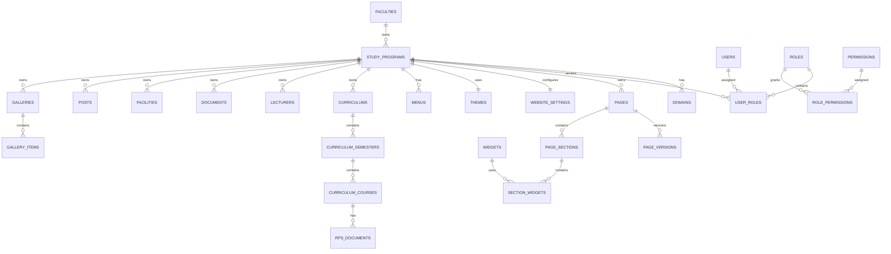
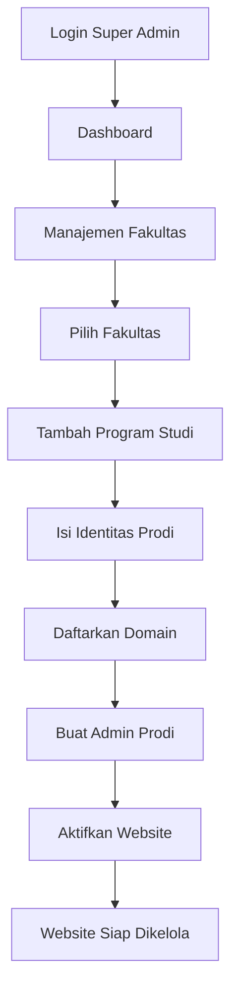
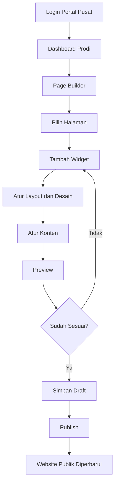
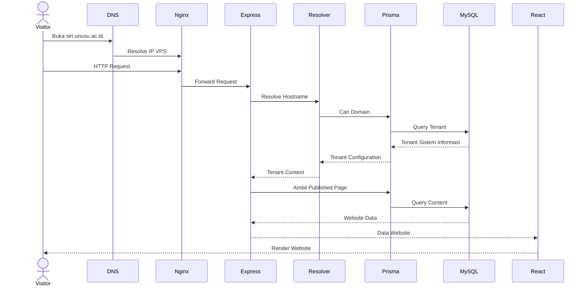
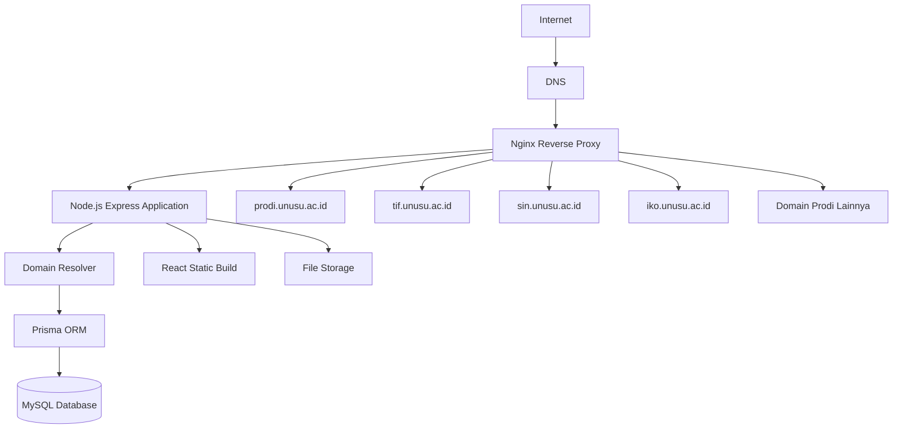

# PRODUCT REQUIREMENTS DOCUMENT (PRD)

# SISTEM MANAJEMEN WEBSITE MULTI-PRODI UNIVERSITAS NUSA UTAMA (UNUSU)


**Versi:** 1.1  

**Status:** Draft – Konsolidasi dokumentasi (2026-11-07)  

**Jenis Aplikasi:** Multi-Tenant Website Management System  

**Arsitektur:** Modular Monolith Fullstack  

**Platform:** Web Application  

**Deployment:** Single VPS – Multiple Domains


---


# 1. OVERVIEW


## 1.1 Latar Belakang


Universitas Nusa Utama (UNUSU) memiliki beberapa fakultas dan program studi yang membutuhkan website resmi masing-masing dengan domain berbeda.


Pengelolaan website secara terpisah menyebabkan beberapa permasalahan:


- Setiap website membutuhkan instalasi aplikasi sendiri.

- Pembaruan fitur harus dilakukan berulang kali.

- Pengelolaan konten tidak terpusat.

- Pengelolaan akun administrator sulit dikontrol.

- Desain website setiap Prodi sulit diseragamkan maupun dikembangkan secara independen.

- Pemeliharaan server dan database menjadi lebih kompleks.


Untuk mengatasi permasalahan tersebut, diperlukan sebuah aplikasi terpusat yang mampu mengelola banyak website Prodi menggunakan satu aplikasi fullstack.


Sistem menyediakan portal administrasi pusat melalui:


****https\://prodi.unusu.ac.id****


Sementara itu, masing-masing website publik tetap menggunakan domain sendiri, misalnya:


- https\://tif.unusu.ac.id

- https\://sin.unusu.ac.id

- https\://iko.unusu.ac.id

- https\://manajemen.unusu.ac.id

- https\://agribisnis.unusu.ac.id


Seluruh website menggunakan backend dan database yang sama, tetapi mempunyai konten, pengguna, konfigurasi, dan desain yang independen.


## 1.2 Tujuan Sistem


1. Membangun satu aplikasi untuk mengelola seluruh website Program Studi UNUSU.

2. Memusatkan autentikasi dan administrasi melalui satu portal.

3. Memberikan akses terpisah kepada administrator masing-masing Prodi.

4. Menyediakan Website Builder berbasis widget.

5. Memungkinkan setiap Prodi membuat desain landing page yang berbeda.

6. Menyediakan CMS untuk mengelola informasi akademik dan administrasi Prodi.

7. Mempermudah penambahan Prodi dan domain baru tanpa membuat aplikasi baru.

8. Mengurangi biaya infrastruktur dan pemeliharaan.


## 1.3 Konsep Utama


Sistem menggunakan konsep:


****One Application – Multiple Websites – Independent Management.****


Artinya:


- Satu aplikasi React.

- Satu backend Node.js.

- Satu database MySQL.

- Satu sistem autentikasi.

- Banyak domain.

- Banyak tenant.

- Setiap tenant memiliki data dan desain independen.


Tidak ada kebutuhan untuk melakukan instalasi aplikasi baru ketika menambahkan website Prodi.


## 1.4 Target Pengguna


- Administrator Universitas.

- Administrator Fakultas (jika modul Fakultas diaktifkan).

- Administrator Program Studi.

- Editor konten.

- Pengunjung website.

- Calon mahasiswa.

- Mahasiswa.

- Dosen dan tenaga kependidikan.


---


# 2. TECHNOLOGY STACK


## 2.1 Frontend


| Teknologi | Kegunaan |

|---|---|

| React | Library UI |

| TypeScript | Type safety |

| Vite | Build tool dan development server |

| Tailwind CSS | Styling |

| shadcn/ui | Komponen antarmuka |

| React Router | Routing |

| TanStack Query | Server state management |

| React Hook Form | Form management |

| Zod | Validasi data |

| Zustand | Client state management |

| Lucide Icons | Ikon |


## 2.2 Backend


| Teknologi | Kegunaan |

|---|---|

| Node.js | Runtime |

| Express.js | Backend framework |

| TypeScript | Type safety |

| Prisma ORM | Database access |

| MySQL | Database |

| Zod | Request validation |

| Multer | Upload file |

| bcrypt/Argon2 | Password hashing |

| Session/JWT | Authentication |

| Helmet | Security headers |


## 2.3 Infrastruktur


| Teknologi | Kegunaan |

|---|---|

| Ubuntu Server | Operating system |

| Nginx | Reverse proxy dan domain routing |

| PM2 | Process management |

| Let's Encrypt | SSL |

| Git | Version control |


## 2.4 Arsitektur Aplikasi


Menggunakan ****Modular Monolith****.


Frontend React dan backend Express berada dalam satu repository dan satu proyek aplikasi. Backend menyediakan API dan menyajikan hasil build frontend.


Seluruh modul berjalan dalam satu aplikasi Node.js.


Struktur yang direkomendasikan:


```text

unusu-multi-website/

│

├── src/

│   ├── client/

│   │   ├── app/

│   │   ├── components/

│   │   ├── layouts/

│   │   ├── pages/

│   │   │   ├── admin/

│   │   │   ├── builder/

│   │   │   └── public/

│   │   ├── features/

│   │   ├── hooks/

│   │   ├── services/

│   │   └── styles/

│   │

│   ├── server/

│   │   ├── modules/

│   │   │   ├── auth/

│   │   │   ├── tenants/

│   │   │   ├── domains/

│   │   │   ├── users/

│   │   │   ├── pages/

│   │   │   ├── menus/

│   │   │   ├── builder/

│   │   │   ├── widgets/

│   │   │   ├── lecturers/

│   │   │   ├── curriculum/

│   │   │   ├── documents/

│   │   │   ├── facilities/

│   │   │   ├── posts/

│   │   │   ├── galleries/

│   │   │   ├── contacts/

│   │   │   └── settings/

│   │   ├── middlewares/

│   │   ├── services/

│   │   ├── config/

│   │   └── app.ts

│   │

│   └── shared/

│       ├── types/

│       ├── schemas/

│       └── constants/

│

├── prisma/

│   ├── schema.prisma

│   ├── migrations/

│   └── seed.ts

│

├── public/

├── uploads/

├── docs/

│   ├── README.md

│   ├── PRD.md

│   ├── ARCHITECTURE.md

│   ├── DATABASE.md

│   ├── DESIGN-RULES.md

│   ├── CHANGELOG.md

│   └── DEVELOPMENT-RULES.md

│

├── tests/

├── .env.example

├── package.json

├── tsconfig.json

└── vite.config.ts

```


****Catatan arsitektur:**** Struktur tersebut merupakan satu proyek, bukan frontend dan backend yang harus di-deploy sebagai dua aplikasi berbeda. Vite digunakan untuk membangun frontend, sedangkan Express menangani API, autentikasi, domain resolution, dan penyajian frontend hasil build.


---


# 3. DOMAIN DAN MULTI-TENANT MANAGEMENT


## 3.1 Portal Administrasi Utama


Domain:


`prodi.unusu.ac.id`


Fungsi:


- Login administrator.

- Dashboard Super Admin.

- Manajemen fakultas dan Prodi.

- Manajemen domain.

- Manajemen pengguna.

- Manajemen hak akses.

- Manajemen widget.

- Manajemen template.

- Monitoring website.

- Konfigurasi sistem.


Portal ini merupakan pintu masuk administrasi seluruh website.


## 3.2 Inventaris Domain


Semua domain yang diberikan menggunakan IP:


`103.116.168.49`


### Fakultas Ilmu Komputer


| Entitas | Domain |

|---|---|

| Fakultas Ilmu Komputer | fasilkom.unusu.ac.id |

| Teknik Informatika | tif.unusu.ac.id |

| Ilmu Komputer | iko.unusu.ac.id |

| Sistem Informasi | sin.unusu.ac.id |


### Fakultas Ilmu Pendidikan


| Entitas | Domain |

|---|---|

| Fakultas Ilmu Pendidikan | fip.unusu.ac.id |

| Pendidikan Guru Sekolah Dasar | pgsd.unusu.ac.id |


### Fakultas Ekonomi


| Entitas | Domain |

|---|---|

| Fakultas Ekonomi | fe.unusu.ac.id |

| Manajemen | manajemen.unusu.ac.id |


### Fakultas Pertanian


| Entitas | Domain |

|---|---|

| Fakultas Pertanian | faperta.unusu.ac.id |

| Agribisnis | agribisnis.unusu.ac.id |

| Ilmu dan Teknologi Pangan | itp.unusu.ac.id |

| Budidaya Pertanian | bdp.unusu.ac.id |


### Fakultas Ilmu Kesehatan


| Entitas | Domain |

|---|---|

| Fakultas Ilmu Kesehatan | fikes.unusu.ac.id |

| Ilmu Gizi | ilmugizi.unusu.ac.id |

| D3 Analis Kesehatan | ankes.unusu.ac.id |


### Fakultas Agama Islam


| Entitas | Domain |

|---|---|

| Fakultas Agama Islam | fai.unusu.ac.id |

| Pendidikan Islam Anak Usia Dini | piaud.unusu.ac.id |

| Pendidikan Agama Islam | pai.unusu.ac.id |

| Hukum Keluarga Islam | hki.unusu.ac.id |

| Studi Islam | studislam.unusu.ac.id |


Total inventaris: 20 domain, terdiri dari 6 domain Fakultas dan 14 domain Program Studi.


Website Fakultas dan website Program Studi merupakan entitas berbeda. Portal administrasi pusat tetap berada pada `prodi.unusu.ac.id`. Aktivasi website Fakultas sebagai tenant dapat dilakukan sesuai keputusan pengelolaan universitas; fokus implementasi awal adalah website Program Studi.


## 3.3 Domain Resolution


Sistem harus dapat mengenali tenant berdasarkan hostname yang mengakses aplikasi.


Contoh:


```text

User membuka:

https\://sin.unusu.ac.id


        ↓


Nginx meneruskan request

        ↓


Express membaca hostname

        ↓


Domain Resolver mencari domain

        ↓


Database menemukan tenant Sistem Informasi

        ↓


Mengambil konfigurasi website

        ↓


React merender website Sistem Informasi

```


Domain Resolver wajib:


1. Mengenali hostname.

2. Memeriksa domain aktif.

3. Menentukan tenant.

4. Mengambil tema tenant.

5. Mengambil konfigurasi navigasi.

6. Mengambil halaman yang sesuai.

7. Mengambil konten tenant.

8. Menolak domain yang tidak terdaftar atau nonaktif.


Dilarang menentukan tenant berdasarkan slug yang dikirim dari frontend tanpa verifikasi hostname di backend.


---


# 4. USER ROLES AND ACCESS CONTROL


## 4.1 Super Admin


Memiliki akses penuh ke seluruh aplikasi.


Hak akses:


- Melihat seluruh tenant.

- Menambahkan Fakultas.

- Menambahkan Program Studi.

- Mengelola domain.

- Mengelola administrator.

- Mengatur role dan permission.

- Mengelola master widget.

- Membuat template website.

- Mengaktifkan dan menonaktifkan widget.

- Melihat seluruh konten Prodi.

- Monitoring aktivitas sistem.

- Mengelola konfigurasi global.


## 4.2 Admin Fakultas


Role opsional apabila pengelolaan website Fakultas diaktifkan.


Hak akses dibatasi pada Fakultas yang menjadi tanggung jawabnya dan entitas Prodi yang diberikan izin.


## 4.3 Admin Prodi


Setiap Prodi mempunyai administrator sendiri.


Contoh:


Admin Sistem Informasi hanya dapat mengelola:


- Website sin.unusu.ac.id.

- Profil Sistem Informasi.

- Kurikulum Sistem Informasi.

- Dosen Sistem Informasi.

- Berita Sistem Informasi.

- Dokumen Sistem Informasi.

- Desain website Sistem Informasi.


Admin Sistem Informasi tidak dapat mengubah konten Teknik Informatika atau Prodi lainnya.


## 4.4 Editor


Hak akses diberikan oleh Admin Prodi.


Contoh:


- Editor berita hanya mengelola berita.

- Editor dokumen hanya mengelola dokumen.

- Editor kurikulum hanya mengelola kurikulum.


## 4.5 Permission System


Menggunakan Role-Based Access Control (RBAC).


Permission menggunakan format:


```text

dashboard.view


website.view

website.update


pages.view

pages.create

pages.update

pages.delete

pages.publish


builder.view

builder.create

builder.update

builder.publish


curriculum.view

curriculum.create

curriculum.update

curriculum.delete


lecturers.view

lecturers.create

lecturers.update

lecturers.delete


posts.view

posts.create

posts.update

posts.delete

posts.publish

```


Seluruh permission diperiksa di backend.


Setiap data tenant harus mempunyai relasi tenant yang jelas. Backend tidak boleh hanya mengandalkan filter di frontend.


---


# 5. PUBLIC WEBSITE STRUCTURE


Seluruh website Program Studi menggunakan struktur menu standar berikut.


Admin dapat mengatur label, urutan, status aktif, dan submenu. Super Admin dapat menentukan menu wajib.


| No. | Menu | URL | Jenis |

|---|---|---|---|

| 1 | Beranda | `/` | Landing Page |

| 2 | Profil | `/profil` | Informasi |

| 3 | Visi & Misi | `/visi-misi` | Informasi |

| 4 | Kurikulum | `/kurikulum` | Data Akademik |

| 5 | Dokumen | `/dokumen` | Repository |

| 6 | Dosen | `/dosen` | Direktori |

| 7 | Sarpras | `/sarana-prasarana` | Informasi |

| 8 | Berita | `/berita` | Publikasi |

| 9 | Galeri | `/galeri` | Multimedia |

| 10 | Kontak | `/kontak` | Informasi |


Setiap Prodi memiliki navigasi independen.


---


# 6. CORE FEATURES


## 6.1 Central Admin Dashboard


Dashboard utama untuk Super Admin.


Fitur:


- Total Fakultas.

- Total Program Studi.

- Total website aktif.

- Total website nonaktif.

- Total administrator.

- Total berita.

- Total dokumen.

- Aktivitas terbaru.

- Daftar domain.

- Status publikasi website.

- Monitoring aktivitas admin.


Dashboard Admin Prodi menampilkan data milik Prodi masing-masing.


## 6.2 Tenant Management


Fitur pengelolaan tenant:


- Tambah tenant.

- Edit tenant.

- Hapus tenant dengan proteksi relasi data.

- Aktifkan/nonaktifkan tenant.

- Hubungkan tenant ke Fakultas.

- Atur identitas Prodi.

- Atur domain.

- Atur logo.

- Atur deskripsi.

- Atur informasi akademik.


Data tenant minimal:


```text

id

faculty_id

name

slug

code

description

logo

status

created_at

updated_at

```


## 6.3 Domain Management


Fitur:


- Tambah domain.

- Edit domain.

- Hapus domain.

- Hubungkan domain ke tenant.

- Status aktif/nonaktif.

- Set primary domain.

- Validasi domain unik.

- Pengaturan SSL dan HTTPS.

- Monitoring domain.


Satu tenant dapat memiliki lebih dari satu domain jika diperlukan.


## 6.4 Website Identity Management


Setiap tenant mempunyai konfigurasi sendiri:


- Nama website.

- Nama universitas.

- Nama Fakultas.

- Nama Program Studi.

- Logo.

- Favicon.

- Alamat.

- Email.

- Nomor telepon.

- Media sosial.

- Copyright.

- SEO title.

- SEO description.

- SEO image.


---


# 7. WEBSITE BUILDER – FITUR UTAMA


Website Builder merupakan fitur inti sistem.


Tujuannya memungkinkan setiap Admin Prodi membangun landing page dengan desain yang berbeda tanpa menulis kode.


## 7.1 Konsep Builder


Sistem menggunakan pendekatan:


****Section-Based Drag & Drop Widget Builder.****


Admin dapat:


- Menambahkan section.

- Menambahkan widget.

- Menghapus widget.

- Mengubah urutan widget.

- Mengatur layout.

- Mengubah konfigurasi widget.

- Mengatur background.

- Mengatur warna.

- Mengatur typography.

- Mengatur spacing.

- Melihat preview.

- Menyimpan draft.

- Mempublikasikan halaman.


## 7.2 Master Widget Library


Widget tersedia dari sistem pusat.


Kategori widget:


### A. Hero & Header


- Hero Banner.

- Hero Split Layout.

- Hero Slider.

- Page Header.

- Breadcrumb.

- Announcement Bar.


### B. Profile & Information


- About Prodi.

- Sambutan Kaprodi.

- Visi & Misi.

- Keunggulan Prodi.

- Profile Card.

- Text Content.


### C. Statistics


- Student Statistics.

- Lecturer Statistics.

- Alumni Statistics.

- Achievement Statistics.

- Counter.


### D. Academic


- Curriculum Overview.

- Curriculum Semester.

- Lecturer List.

- Lecturer Carousel.

- Research Information.

- Academic Information.


### E. Publication


- Latest News.

- News Grid.

- News Carousel.

- Announcement.

- Document List.

- Gallery Grid.


### F. Facilities


- Facility Grid.

- Facility Carousel.

- Laboratory.

- Campus Information.


### G. Supporting


- Testimonials.

- Partners.

- FAQ.

- CTA.

- Contact Information.

- Google Maps.

- Social Media.

- Footer.


## 7.3 Widget Configuration


Setiap widget mempunyai konfigurasi berbeda.


Contoh konfigurasi Hero:


```json

{

  "title": "Program Studi Sistem Informasi",

  "subtitle": "Mencetak lulusan unggul...",

  "background": {

    "type": "image",

    "value": "/uploads/hero.jpg",

    "overlay": true

  },

  "layout": "split",

  "alignment": "left",

  "buttons": [

    {

      "label": "Profil Prodi",

      "url": "/profil",

      "variant": "primary"

    }

  ]

}

```


Contoh konfigurasi Statistics:


```json

{

  "layout": "four-columns",

  "items": [

    {

      "label": "Mahasiswa",

      "value": 250,

      "icon": "users"

    },

    {

      "label": "Dosen",

      "value": 15,

      "icon": "graduation-cap"

    },

    {

      "label": "Mata Kuliah",

      "value": 66,

      "icon": "book-open"

    },

    {

      "label": "SKS",

      "value": 148,

      "icon": "award"

    }

  ]

}

```


## 7.4 Widget Variants


Setiap widget dapat mempunyai beberapa variasi tampilan.


Contoh:


```text

Hero Banner

├── Classic

├── Split Image

├── Full Background

├── Modern Minimal

└── Slider


News

├── Grid

├── List

├── Featured

└── Carousel


Lecturer

├── Grid Card

├── Horizontal Card

├── Compact List

└── Carousel

```


Variasi tersebut harus dikembangkan sebagai komponen React yang reusable.


## 7.5 Drag & Drop


Builder wajib mendukung:


- Drag widget dari library.

- Drop widget ke halaman.

- Reorder widget.

- Reorder section.

- Duplikasi widget.

- Duplikasi section.

- Delete.

- Undo/Redo (dapat menggunakan riwayat perubahan).

- Pengaturan responsive.


## 7.6 Responsive Preview


Builder mempunyai mode preview:


- Desktop.

- Tablet.

- Mobile.


Preview harus menggunakan komponen renderer yang sama dengan website publik agar hasilnya konsisten.


## 7.7 Draft dan Publish


Setiap perubahan desain disimpan sebagai draft.


Alur:


```text

Admin mengedit halaman

        ↓

Simpan Draft

        ↓

Preview

        ↓

Validasi

        ↓

Publish

        ↓

Website publik diperbarui

```


Sistem harus mendukung penyimpanan versi publik dan draft secara terpisah.


Perubahan pada satu tenant tidak boleh memengaruhi tenant lainnya.


## 7.8 Page Builder untuk Halaman Lain


Builder tidak hanya digunakan pada halaman Beranda.


Halaman Profil, Visi & Misi, dan Sarpras juga dapat menggunakan section builder.


Untuk halaman dengan data terstruktur seperti Kurikulum, Dosen, Berita, Dokumen, dan Galeri, builder hanya boleh mengatur layout dan tampilan komponen.


Builder tidak boleh menghilangkan fungsi CRUD, pencarian, filter, atau relasi data modul.


---


# 8. CMS DAN ADMINISTRASI WEBSITE


## 8.1 Beranda


Konten:


- Hero banner.

- Profil singkat.

- Sambutan Kaprodi.

- Statistik.

- Berita terbaru.

- Informasi dosen.

- Keunggulan Prodi.

- Galeri.

- CTA.

- Footer.


Seluruh susunan dapat dikustomisasi melalui Builder.


## 8.2 Profil


Fitur:


- Sejarah Prodi.

- Deskripsi.

- Identitas Prodi.

- Tujuan.

- Sasaran.

- Struktur organisasi.

- Foto pendukung.


## 8.3 Visi & Misi


Fitur:


- Visi.

- Misi.

- Tujuan.

- Sasaran strategis.

- Edit konten.

- Pengaturan tampilan.


## 8.4 Kurikulum


Modul Kurikulum merupakan modul akademik penting.


Fitur:


- Tambah kurikulum.

- Edit kurikulum.

- Hapus kurikulum.

- Menentukan tahun kurikulum.

- Mengatur semester.

- Mengelola mata kuliah.

- Upload RPS.

- Download RPS.

- Pencarian mata kuliah.

- Filter semester.

- Statistik akademik.


### Struktur Kurikulum


Setiap kurikulum memiliki beberapa semester.


Setiap semester memiliki mata kuliah.


Data mata kuliah:


| Field | Keterangan |

|---|---|

| Kode MK | Kode mata kuliah |

| Nama MK | Nama mata kuliah |

| SKS | Bobot SKS |

| Semester | Semester mata kuliah |

| Keterangan | Wajib, pilihan, praktik |

| RPS | File RPS |

| Deskripsi | Deskripsi mata kuliah |


### Contoh Data Sistem Informasi


Data referensi dari contoh yang diberikan:


- 8 semester.

- 66 mata kuliah.

- 148 SKS.

- 66 RPS tersedia.


Distribusi:


| Semester | Mata Kuliah | SKS |

|---|---:|---:|

| 1 | 10 | 21 |

| 2 | 11 | 21 |

| 3 | 11 | 20 |

| 4 | 10 | 20 |

| 5 | 8 | 20 |

| 6 | 8 | 21 |

| 7 | 7 | 19 |

| 8 | 1 | 6 |

| ****Total**** | ****66**** | ****148**** |


Angka di atas merupakan data referensi, bukan angka yang di-hardcode ke aplikasi.


Statistik harus dihitung berdasarkan database.


### Halaman Publik Kurikulum


Menampilkan:


1. Judul Kurikulum.

2. Deskripsi.

3. Total semester.

4. Total mata kuliah.

5. Total SKS.

6. Total RPS.

7. Search mata kuliah.

8. Filter semester.

9. Tabel mata kuliah.

10. Tombol Lihat RPS.


Format tabel:


| Kode MK | Nama MK | SKS | Keterangan | RPS |

|---|---|---:|---|---|

| ILK 110 | Kalkulus | 3 | Wajib | Lihat RPS |

| ILK 120 | Pengantar Teknologi Informasi | 2 | Wajib | Lihat RPS |


URL RPS:


`/kurikulum/:courseId/rps`


## 8.5 Dokumen


Fitur:


- Upload PDF.

- Kategori dokumen.

- Nama dokumen.

- Deskripsi.

- Tahun.

- Tanggal upload.

- Preview dokumen.

- Download.

- Search.

- Filter kategori.


## 8.6 Dosen


Fitur:


- Tambah dosen.

- Edit dosen.

- Hapus dosen.

- Upload foto.

- Nama dan gelar.

- NIDN/NIDK.

- Jabatan akademik.

- Pendidikan.

- Bidang keahlian.

- Email.

- Profil.


## 8.7 Sarana dan Prasarana


Fitur:


- Tambah fasilitas.

- Edit fasilitas.

- Upload gambar.

- Nama fasilitas.

- Deskripsi.

- Lokasi.

- Kategori.

- Status.


## 8.8 Berita


Fitur:


- Buat berita.

- Edit berita.

- Hapus berita.

- Draft.

- Publish.

- Jadwal publikasi.

- Kategori.

- Thumbnail.

- Rich text editor.

- SEO.

- Berita terkait.


## 8.9 Galeri


Fitur:


- Buat album.

- Upload banyak foto.

- Upload video atau embed video.

- Kategori.

- Deskripsi.

- Tanggal kegiatan.

- Cover album.

- Pengaturan publikasi.


## 8.10 Kontak


Fitur:


- Alamat.

- Email.

- Telepon.

- WhatsApp.

- Google Maps.

- Media sosial.

- Formulir pesan.


---


# 9. THEME MANAGEMENT


Setiap Prodi dapat mempunyai identitas visual berbeda.


Pengaturan tema:


- Primary color.

- Secondary color.

- Accent color.

- Background.

- Typography.

- Font heading.

- Font body.

- Border radius.

- Shadow.

- Button style.

- Header layout.

- Footer layout.

- Container width.


Contoh:


```json

{

  "colors": {

    "primary": "#14532D",

    "secondary": "#64748B",

    "accent": "#EAB308",

    "background": "#FFFFFF",

    "foreground": "#172033"

  },

  "typography": {

    "heading": "Plus Jakarta Sans",

    "body": "Inter"

  },

  "layout": {

    "container": "1280px",

    "header": "modern",

    "footer": "multi-column"

  }

}

```


Tema harus disimpan per tenant.


Mengubah tema Sistem Informasi tidak boleh mengubah tema Teknik Informatika.


---


# 10. DATABASE DESIGN


Database menggunakan MySQL dan Prisma ORM.


Pendekatan database: Shared Database – Shared Schema – Tenant Scoped Data.


## 10.1 Core Tables


| Tabel | Fungsi |

|---|---|

| faculties | Data fakultas |

| study_programs | Data Prodi |

| domains | Domain website |

| users | Akun pengguna |

| roles | Role |

| permissions | Permission |

| user_roles | Relasi user dan role |

| role_permissions | Relasi role dan permission |


## 10.2 Website Management


| Tabel | Fungsi |

|---|---|

| website_settings | Identitas website |

| themes | Tema website |

| menus | Navigasi |

| pages | Halaman |

| page_versions | Riwayat versi halaman |

| page_sections | Section halaman |

| widgets | Master widget |

| section_widgets | Widget yang digunakan |

| widget_variants | Variasi widget |

| media | File media |


## 10.3 CMS Tables


| Tabel | Fungsi |

|---|---|

| profiles | Profil Prodi |

| visions_missions | Visi dan misi |

| curriculums | Kurikulum |

| curriculum_semesters | Semester |

| curriculum_courses | Mata kuliah |

| rps_documents | File RPS |

| lecturers | Dosen |

| documents | Repository dokumen |

| facilities | Sarana prasarana |

| posts | Berita |

| post_categories | Kategori berita |

| galleries | Album galeri |

| gallery_items | Foto dan video |

| contacts | Informasi kontak |


## 10.4 System Tables


| Tabel | Fungsi |

|---|---|

| audit_logs | Riwayat aktivitas |

| sessions | Session pengguna |

| notifications | Notifikasi |

| contact_messages | Pesan pengunjung |

| system_settings | Pengaturan global |


## 10.5 Relasi Data


Aturan utama:


- Satu Fakultas memiliki banyak Prodi.

- Satu Prodi memiliki satu atau lebih domain.

- Satu Prodi memiliki banyak pengguna.

- Satu Prodi memiliki banyak halaman.

- Satu halaman memiliki banyak section.

- Satu section memiliki banyak widget.

- Satu Prodi memiliki banyak berita, dosen, dokumen, fasilitas, dan kurikulum.

- Satu kurikulum memiliki banyak semester.

- Satu semester memiliki banyak mata kuliah.

- Satu mata kuliah dapat memiliki dokumen RPS.


Seluruh data yang bersifat tenant-specific wajib mempunyai `study_program_id` atau hubungan tenant yang dapat diverifikasi.


Jangan menggunakan `tenant_id` dari request frontend sebagai satu-satunya dasar otorisasi.


## 10.6 Mermaid ERD





---


# 11. USER FLOW


## 11.1 Super Admin Membuat Website Prodi





## 11.2 Admin Prodi Mengatur Website





## 11.3 Pengunjung Mengakses Website





---


# 12. API DESIGN


Backend menggunakan REST API.


Base URL:


`/api/v1`


## Authentication


```text

POST   /api/v1/auth/login

POST   /api/v1/auth/logout

GET    /api/v1/auth/me

POST   /api/v1/auth/refresh

```


## Tenant Management


```text

GET    /api/v1/tenants

POST   /api/v1/tenants

GET    /api/v1/tenants/:id

PUT    /api/v1/tenants/:id

DELETE /api/v1/tenants/:id

```


## Domain Management


```text

GET    /api/v1/domains

POST   /api/v1/domains

PUT    /api/v1/domains/:id

DELETE /api/v1/domains/:id

```


## Page Builder


```text

GET    /api/v1/pages

POST   /api/v1/pages

GET    /api/v1/pages/:id

PUT    /api/v1/pages/:id


POST   /api/v1/pages/:id/sections

PUT    /api/v1/sections/:id

DELETE /api/v1/sections/:id


POST   /api/v1/sections/:id/widgets

PUT    /api/v1/widgets/:id

DELETE /api/v1/widgets/:id


POST   /api/v1/pages/:id/preview

POST   /api/v1/pages/:id/publish

```


## Curriculum


```text

GET    /api/v1/curriculums

POST   /api/v1/curriculums

PUT    /api/v1/curriculums/:id


GET    /api/v1/curriculums/:id/semesters

POST   /api/v1/semesters

PUT    /api/v1/semesters/:id


GET    /api/v1/courses

POST   /api/v1/courses

PUT    /api/v1/courses/:id

DELETE /api/v1/courses/:id


POST   /api/v1/courses/:id/rps

GET    /api/v1/courses/:id/rps

```


## Public Website


```text

GET    /api/v1/public/site

GET    /api/v1/public/pages/:slug

GET    /api/v1/public/menus

GET    /api/v1/public/curriculum

GET    /api/v1/public/lecturers

GET    /api/v1/public/documents

GET    /api/v1/public/facilities

GET    /api/v1/public/posts

GET    /api/v1/public/galleries

GET    /api/v1/public/contact

```


Public endpoint mengambil tenant berdasarkan hostname yang sudah diverifikasi oleh backend.


---


# 13. SECURITY REQUIREMENTS


Keamanan merupakan kebutuhan wajib.


1. Password harus di-hash menggunakan Argon2 atau bcrypt.

2. Implementasikan RBAC.

3. Setiap request admin harus melalui autentikasi dan otorisasi backend.

4. Setiap query data tenant wajib dibatasi berdasarkan tenant context.

5. Jangan mempercayai `study_program_id` dari frontend.

6. Terapkan proteksi CSRF jika menggunakan cookie-based session.

7. Terapkan rate limiting pada login.

8. Gunakan HTTP-only dan Secure cookie.

9. Validasi semua input menggunakan Zod.

10. Batasi tipe dan ukuran file upload.

11. Gunakan nama file yang aman dan unik.

12. Lindungi endpoint upload.

13. Gunakan HTTPS untuk seluruh domain.

14. Catat aktivitas penting ke audit log.

15. Cegah akses langsung terhadap file privat.

16. Backup database secara berkala.

17. Terapkan transaksi database untuk operasi penting.


File RPS dan dokumen publik dapat diakses pengunjung sesuai status publikasi. Dokumen privat hanya boleh diakses pengguna yang berwenang.


---


# 14. NON-FUNCTIONAL REQUIREMENTS


## Performance


- Website publik harus cepat dimuat.

- Gunakan pagination pada daftar data.

- Optimalkan gambar.

- Gunakan lazy loading.

- Hindari query N+1.

- Gunakan caching untuk konfigurasi website yang sering diakses.

- Gunakan database indexing untuk pencarian.


## Scalability


- Penambahan tenant tidak membutuhkan instalasi aplikasi baru.

- Penambahan domain tidak membutuhkan backend baru.

- Widget harus reusable.

- Modul harus independen secara logis.

- Database mendukung pertumbuhan jumlah konten.


## Maintainability


- Menggunakan TypeScript.

- Struktur modular.

- Reusable components.

- Validasi terpusat.

- Error handling terpusat.

- Dokumentasi teknis.

- Prisma migrations.

- Automated tests.


## SEO


- Setiap domain memiliki SEO metadata independen.

- Setiap halaman mempunyai title dan description.

- Sitemap per domain.

- Canonical URL.

- Open Graph.

- URL slug yang ramah mesin pencari.


## Responsive


Seluruh website wajib mendukung:


- Desktop.

- Laptop.

- Tablet.

- Smartphone.


---


# 15. ADMINISTRATIVE INTERFACE


## 15.1 Menu Super Admin


```text

Dashboard


Manajemen Organisasi

├── Fakultas

└── Program Studi


Website Management

├── Daftar Website

├── Domain

├── Website Settings

└── Website Monitoring


User Management

├── Pengguna

├── Roles

└── Permissions


Website Builder

├── Widget Library

├── Widget Variants

└── Template Library


System Management

├── Media Library

├── Audit Logs

├── Notifications

└── System Settings

```


## 15.2 Menu Admin Prodi


```text

Dashboard


Website

├── Identitas Website

├── Navigasi

├── Page Builder

└── Theme Settings


Konten

├── Profil

├── Visi & Misi

├── Kurikulum

├── Dokumen

├── Dosen

├── Sarpras

├── Berita

├── Galeri

└── Kontak


Pengelolaan

├── Media Library

├── Pengguna / Editor

└── Audit Aktivitas

```


Menu harus ditampilkan berdasarkan permission pengguna.


---


# 16. DEPLOYMENT ARCHITECTURE


Semua domain diarahkan ke satu VPS.


IP:


`103.116.168.49`


Arsitektur:





## Deployment Rules


- Satu aplikasi Node.js.

- Satu proses PM2.

- Satu database MySQL.

- Semua domain menggunakan konfigurasi Nginx yang mengarah ke aplikasi yang sama.

- SSL aktif pada setiap domain.

- Hostname diteruskan secara aman ke backend.

- File upload dikelola melalui storage terpusat.

- Database dan file penting mempunyai backup.


---


# 17. TESTING REQUIREMENTS


Sistem harus melalui pengujian sebelum production.


## Functional Testing


- Login setiap role.

- Pembuatan tenant.

- Pembuatan domain.

- Pengelolaan konten.

- Widget Builder.

- Draft dan Publish.

- Pengelolaan kurikulum.

- Upload dan download RPS.

- Pengelolaan dosen.

- Pengelolaan berita.

- Pengelolaan galeri.


## Tenant Isolation Testing


Contoh pengujian:


- Admin Sistem Informasi tidak dapat mengubah data Teknik Informatika.

- Admin Teknik Informatika tidak dapat mengakses halaman administrasi Sistem Informasi.

- Widget tenant A tidak boleh tampil pada tenant B.

- Tema tenant A tidak boleh memengaruhi tenant B.

- Dokumen tenant A tidak dapat diakses melalui endpoint privat tenant B.

- Manipulasi ID di request tidak boleh membuka data tenant lain.


## Builder Testing


- Tambah widget.

- Hapus widget.

- Reorder.

- Duplikasi.

- Edit konfigurasi.

- Preview.

- Publish.

- Draft.

- Responsive preview.

- Validasi konfigurasi widget yang tidak valid.


## Performance Testing


- Simulasi banyak domain.

- Simulasi beberapa pengguna bersamaan.

- Pengujian query database.

- Pengujian upload dokumen.

- Pengujian cache.


---


# 18. ACCEPTANCE CRITERIA


Sistem dinyatakan memenuhi kebutuhan utama apabila:


1. Super Admin dapat mengelola tenant melalui satu portal.

2. Admin setiap Prodi memiliki akun sendiri.

3. Semua domain dapat diarahkan ke satu aplikasi.

4. Domain Resolver dapat menentukan website yang benar.

5. Setiap website memiliki data independen.

6. Setiap website dapat menggunakan desain berbeda.

7. Admin dapat menyusun landing page menggunakan Widget Builder.

8. Widget dapat diatur dan dikonfigurasi.

9. Tersedia fitur draft dan publish.

10. Tersedia 10 menu publik standar.

11. Setiap menu mempunyai modul pengelolaan sesuai jenis datanya.

12. Kurikulum mendukung semester, mata kuliah, SKS, dan RPS.

13. Sistem dapat menambahkan Prodi baru tanpa membuat aplikasi baru.

14. Sistem mendukung responsive design.

15. Pengujian isolasi tenant berhasil.

16. Seluruh domain menggunakan HTTPS.

17. Tidak terjadi kebocoran data antar-Prodi.


---


# 19. DEVELOPMENT ROADMAP


Pengembangan dilakukan bertahap agar fitur utama selesai dan bisa diuji sebelum melanjutkan ke tahap berikutnya.


## Phase 1 – Foundation


- Setup React, Vite, Express, TypeScript.

- Setup Prisma dan MySQL.

- Setup struktur Modular Monolith.

- Authentication.

- RBAC.

- Fakultas dan Prodi.

- Tenant Resolver.

- Domain Management.


****Output:**** Fondasi multi-tenant berjalan.


## Phase 2 – Website Management


- Website Settings.

- Theme Management.

- Menu Management.

- Page Management.

- Media Library.

- Public Website Renderer.


****Output:**** Setiap domain sudah dapat menampilkan website Prodi masing-masing.


## Phase 3 – Website Builder


- Widget Registry.

- Widget Library.

- Widget Variants.

- Section Builder.

- Drag & Drop.

- Widget Configuration.

- Responsive Preview.

- Draft dan Publish.

- Version Management.


****Output:**** Setiap Prodi dapat membuat desain website sendiri.


## Phase 4 – CMS Modules


- Profil.

- Visi & Misi.

- Kurikulum.

- Dokumen.

- Dosen.

- Sarpras.

- Berita.

- Galeri.

- Kontak.


****Output:**** Seluruh modul administrasi dan publik berjalan.


## Phase 5 – System Management


- Audit Logs.

- Notification.

- SEO.

- Sitemap.

- Backup.

- Monitoring.

- Security hardening.


****Output:**** Sistem siap production.


## Phase 6 – Production Deployment


- Setup VPS.

- Setup MySQL.

- Setup Nginx.

- Setup SSL seluruh domain.

- PM2.

- Migrasi database.

- Seed data awal.

- Testing domain.

- UAT.

- Go Live.


****Output:**** Website Prodi UNUSU dapat digunakan secara resmi.


---


# 20. DEVELOPMENT RULES FOR AI CODING AGENTS


Seluruh proses pengembangan wajib mengikuti aturan berikut.


1. Baca `docs/PRD.md` sebelum melakukan implementasi.

2. Baca `docs/ARCHITECTURE.md` sebelum mengubah struktur aplikasi.

3. Baca `docs/DATABASE.md` sebelum mengubah schema Prisma.

4. Baca `docs/DESIGN-RULES.md` sebelum mengerjakan UI.

5. Baca `docs/CHANGELOG.md` sebelum melanjutkan pekerjaan sebelumnya.

6. Jangan membuat implementasi yang bertentangan dengan PRD.

7. Jangan membuat aplikasi terpisah untuk setiap tenant.

8. Jangan membuat komponen khusus per Prodi apabila komponen reusable dapat digunakan.

9. Semua konten tenant harus mempunyai isolasi data.

10. Semua operasi penting harus melalui validasi backend.

11. Jangan menggunakan data hardcoded untuk menggantikan database production.

12. Jangan mengubah konfigurasi tenant lain ketika mengerjakan tenant tertentu.

13. Gunakan Prisma Migration untuk perubahan database.

14. Setiap fitur harus memiliki pengujian.

15. Update changelog setiap menyelesaikan fitur.

16. Jangan menghapus fitur yang sudah berjalan tanpa persetujuan.

17. Gunakan desain UI yang konsisten, modern, minimalis, dan profesional.

18. Hindari UI generik hasil AI, penggunaan gradient berlebihan, neon, dan glassmorphism berlebihan.

19. Dashboard menggunakan layout dashboard khusus, bukan generic page layout.

20. Halaman selain dashboard menggunakan page template yang sudah disediakan.


---


# 21. OUT OF SCOPE – TAHAP PERTAMA


Fitur berikut tidak menjadi fokus implementasi awal:


- Sistem akademik KRS dan KHS.

- Sistem penerimaan mahasiswa baru.

- Sistem pembayaran UKT.

- Sistem e-learning.

- Sistem informasi kepegawaian.

- Integrasi SIAKAD.

- Integrasi SSO universitas.

- Website Fakultas sebagai tenant aktif, kecuali diputuskan untuk diaktifkan.

- Aplikasi mobile native.


Sistem ini berfokus pada manajemen website, konten, informasi akademik publik, dan administrasi website Program Studi.


---


# 22. DEFINITION OF DONE


Pengembangan dinyatakan selesai apabila:


- Semua kebutuhan utama PRD telah diimplementasikan.

- Seluruh modul dapat digunakan.

- Semua domain terdaftar dapat menampilkan tenant yang benar.

- Setiap Admin Prodi dapat mengelola website sendiri.

- Website Builder dapat digunakan tanpa coding.

- Setiap website memiliki desain independen.

- Data antar-Prodi terisolasi.

- Seluruh halaman responsive.

- Tidak ada error kritis.

- Automated testing lulus.

- Dokumentasi teknis tersedia.

- Deployment production berhasil.

- Backup dan prosedur recovery tersedia.


---


# 23. FINAL PROJECT VISION


Sistem ini bukan sekadar CMS biasa.


Sistem ini merupakan ****Centralized Multi-Tenant Website Platform**** yang memungkinkan Universitas Nusa Utama mengelola seluruh website Program Studi melalui satu aplikasi.


Prinsip akhirnya:


****ONE CODEBASE****


****ONE BACKEND****


****ONE DATABASE****


****ONE CENTRAL ADMIN****


****MULTIPLE INDEPENDENT WEBSITES****


****INDEPENDENT DESIGN PER STUDY PROGRAM****


Setiap Program Studi bebas membangun identitas digitalnya masing-masing, sementara universitas tetap mempunyai kendali penuh terhadap infrastruktur, keamanan, dan pengelolaan sistem secara keseluruhan.
